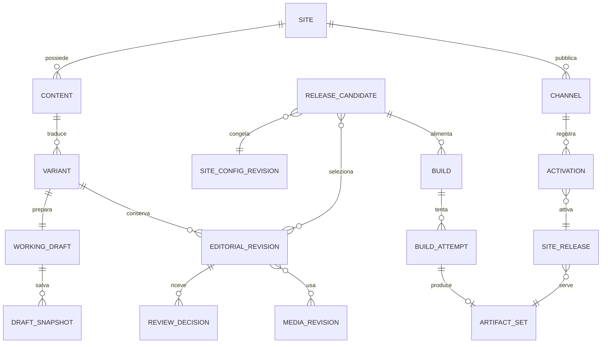

# 02 · Modello di dominio

Stato: proposta concettuale, non schema SQL né API approvata. Le parole inglesi
identificano concetti per il confronto e non classi già disponibili.

## Identità e confini

Il modello attuale riguarda più siti gestiti da un unico amministratore o team.
Site delimita il contesto editoriale e operativo; non rappresenta un tenant.
La gestione di clienti indipendenti e il relativo isolamento sono rinviati.

Gli identificatori sono opachi, stabili e assegnati dal prodotto. Slug, percorso,
titolo, email e chiave S3 non sono identificatori editoriali. Le entità soggette a
modifica portano un contatore di generazione per il controllo di concorrenza.
Date registrate in UTC; calendario editoriale visualizzato nel fuso del sito.

| Entità | Responsabilità, relazioni e identità |
|---|---|
| Installation | Confine operativo e amministrativo; collega istanze kajenn, backend di catalogo e mount storage; database facoltativo |
| Site | Identità editoriale e confine dei permessi; possiede lingue, contenuti, configurazioni e canali |
| SiteLocale | Lingua abilitata e regole degli URL; codice di lingua distinto dall'ID della variante |
| PublicationChannel | Destinazione logica, per esempio collaudo/produzione; appartiene a un sito; puntatore `active_release_id` e generazione |
| DomainBinding | Associazione verificata dominio/prefisso/canale; stato operativo e prova di controllo; nessun provisioning DNS implicito |
| SiteConfigRevision | Snapshot immutabile di origine canonica, lingue, URL, navigazione, impostazioni SEO e selezioni tematiche |
| ContentTypeRevision | Schema immutabile di campi, vincoli e layout consentiti; tipo logico stabile, evoluzione esplicita delle revisioni |
| Content | Identità comune a tutte le traduzioni; sito, tipo logico, stato di archiviazione |
| ContentVariant | Identità di un contenuto in una lingua; unica per contenuto/lingua; punta alla bozza corrente |
| WorkingDraft | Contesto di lavoro di una variante; testa mutabile e generazione; bozza condivisa per variante, scelta acquisita; conflitti espliciti tra modifiche concorrenti |
| DraftSnapshot | Salvataggio immutabile di blocchi HTML o Markdown, metadati e riferimenti; formato canonico dichiarato per blocco, privato, conservazione propria |
| EditorialRevision | Checkpoint immutabile firmato da un attore; variante, predecessore/i, snapshot e schema; revisione sottoponibile a valutazione |
| ReviewRequest / ReviewDecision | Richiesta, assegnatari, commenti e decisioni su una revisione esatta e una versione della policy |
| Contributor | Identità di autore/revisore; collegamento facoltativo al principal di autenticazione; profilo pubblico versionato |
| Taxonomy / TermRevision | Vocabolari, termini localizzati e gerarchie; ID stabili, etichette e percorsi versionati |
| CollectionRevision | Sequenza di riferimenti a contenuti: serie, corso, capitoli, lezioni; ordine e gerarchia immutabili per edizione |
| NavigationRevision | Albero di menu localizzato con destinazioni interne per ID o URL esterni; nessuna copia del titolo salvo override deliberato |
| RouteEntry / RedirectEntry | Risultato congelato della risoluzione URL nella release; stato HTTP, destinazione e lingua |
| MediaAsset / MediaRevision | Identità di una risorsa e revisioni dei suoi byte/metadati; diritti, attribuzione, dimensioni, MIME e checksum |
| MediaRendition | Derivato di una revisione con ricetta e versione del trasformatore: miniature, formati, sottotitoli |
| MediaUse | Uso di una revisione media in uno snapshot: didascalia, testo alternativo, ritaglio e destinazione; contesto localizzato |
| ThemeRevision | Bundle immutabile di template, CSS/JS, font e risorse, con dipendenze esatte |
| TemplateRevision | Sorgente dichiarativo Gramlot oppure HtmlBuilder, motore/versione, contratto degli slot Data e risorse richieste |
| SourceResourceRevision | Sorgente versionato con ID, percorso logico, linguaggio, byte e digest; template Python, CSS, JS e risorse di tema |
| SourceWorkspace / SourceChangeSet | Testa di lavoro e insieme coerente di modifiche a sorgenti e mapping; base e generazione, finalizzazione delle revisioni selezionate |
| DataContractRevision | Schema e mapping versionati dei blocchi nominati definiti dal template e degli altri campi Data; ogni blocco ha sorgente HTML o Markdown; distingue sorgenti, frammenti HTML preparati e dati strutturati |
| ComponentDefinitionRevision | Tipo registrato di componente, schema proprietà, dipendenze e contratto di fallback |
| ComponentInstance | Blocco dentro uno snapshot con ID locale stabile, tipo/versione, proprietà e contenuto statico |
| ReleaseCandidate | Selezione immutabile degli input del sito; può includere revisioni proposte per anteprima, ammesse dalla policy del sito per produzione |
| Build / BuildAttempt | Obiettivo di compilazione e tentativi; input congelati, stato operativo, diagnostica e artefatti prodotti |
| ArtifactSet | Insieme immutabile di HTML, asset, route, sitemap e manifest, con checksum |
| SiteRelease | Manifest sigillato che unisce selezione editoriale e ArtifactSet verificato; appartiene a sito e canale |
| Activation | Evento durevole di passaggio del canale da una release a un'altra; attore, motivo, generazioni ed esito |
| PreviewGrant | Accesso temporaneo a una selezione/artefatto preciso; scadenza, ambito e revoca |
| RoleGrant / AuditEntry | Permesso su sito/canale/azione e registrazione attribuibile delle transizioni |
| Job / JobAttempt | Lavoro applicativo durevole e tentativi di esecuzione; chiave idempotente e identificatore del task kajenn |
| OutboxEvent / IntegrationDelivery | Evento commesso con il dato e consegna per destinatario; retry, deduplicazione, esito incerto |

Un corso è una collezione strutturata di contenuti, non un articolo con una lista
di URL. Prerequisiti didattici e ordine sono relazioni diverse: entrambi sono
validati; l'avanzamento personale di uno studente appartiene a un servizio
distinto. Le tassonomie classificano; i menu navigano; le collezioni organizzano
un percorso. Non devono essere usati l'uno come surrogato dell'altro.

## Relazioni principali

Il diagramma sintetizza il nucleo; temi, collezioni e tassonomie sono anch'essi
input congelati del candidato. Una release pronta non è necessariamente attiva.
Un contenuto può avere una revisione pubblicata, una approvata e una nuova bozza
contemporaneamente: un solo campo `status=published` sull'articolo perderebbe
questa informazione.

## Stati e transizioni

| Aggregato | Transizioni proposte e vincoli |
|---|---|
| Contenuto | Attivo → archiviato → recuperato; eliminazione fisica separata e soggetta a retention |
| Bozza | Testa N → testa N+1 tramite CAS; il conflitto non altera nessuna delle due versioni |
| Revisione | Una volta finalizzata è immutabile; disponibilità e revoca sono registri operativi separati |
| Richiesta di revisione | Aperta → approvata / modifiche richieste / rifiutata / annullata; le decisioni dei singoli revisori restano distinte dall'esito aggregato |
| Approvazione | Valida → revocata; la revoca è una nuova registrazione con motivo, non modifica della decisione originaria |
| Upload | In corso → in verifica → disponibile oppure quarantena/scaduto |
| Build | In coda → in esecuzione → riuscita / fallita / annullata; ogni retry ha un tentativo distinto |
| Release | Pronta oppure non più attivabile; «attiva» è una relazione del canale, non uno stato unico globale |
| Attivazione programmata | Pianificata → eseguita / in conflitto / fallita / annullata; nuova base o permessi revocati impediscono esecuzione |

È acquisita la pubblicazione diretta per chi dispone del relativo permesso;
la revisione preventiva è configurabile per sito. Se abilitata, la
policy versionata stabilisce revisori richiesti, quorum, separazione autore/
revisore, gestione delle decisioni discordanti e scadenza eventuale. Un quorum
non è implicito nella presenza di almeno un'approvazione. La selezione destinata
alla produzione riporta policy e decisioni valutate; la transizione controlla
anche revoche e requisiti correnti.

## Autorità dei dati

Il catalogo è un contratto di persistenza del prodotto: nella prima
implementazione è su filesystem; in futuro potrà usare Asqueel/PostgreSQL.
Include stato operativo e transizioni, non solo ricerca. I servizi non
dipendono dal formato dei file né da query SQL. Un solo backend è autorevole
per ogni installazione; la migrazione non introduce due cataloghi modificabili.

| Informazione | Fonte autorevole | Duplicazioni consentite |
|---|---|---|
| Identità, appartenenze, grant, canali, puntatori di bozza e attivazione | Catalogo autorevole su filesystem; in futuro backend Asqueel | Cache con generazione e invalidazione |
| Blocchi sorgente HTML/Markdown e metadati editoriali di uno snapshot | Manifest immutabile nello storage, con formato e riferimento esatto a ciascun blob | Proiezioni ricostruibili per titolo, ricerca, slug proposto e filtri; sempre associate all'ID e hash sorgente |
| Configurazione editoriale, schemi, menu, termini, collezioni e profili pubblici | Revisioni immutabili nello storage | Indici ricostruibili per gestione e dipendenze |
| Workflow e approvazioni | Catalogo; decisioni immutabili collegate alla revisione | Riepilogo nell'export; nessuno stato modificabile nel front matter |
| Byte di media, sorgenti template/CSS/JS, mapping Data, derivati, temi e artefatti | Storage immutabile | Cache e repliche verificate |
| Data Bag preparata per il rendering | Derivazione deterministica dalle revisioni selezionate e dal DataContractRevision | Snapshot di build con hash; nessuna seconda copia modificabile dei contenuti |
| Prenotazioni operative di percorsi | Catalogo | Il route manifest della release fotografa il risultato pubblicato |
| Route effettivamente servite | Manifest della release selezionata dal canale | Indice in memoria identificato dalla stessa release |
| Job applicativi, audit e outbox | Catalogo | Task spool kajenn come registro dell'esecuzione, non seconda autorità sull'esito editoriale |
| Segreti, connessioni, mount, certificati | Configurazione protetta dell'host/deployment | Nei manifest solo riferimenti logici, mai segreti |

Le relazioni editoriali immutabili, per esempio gli usi dei media, vivono nel
manifest; le loro tabelle di ricerca sono proiezioni. Relazioni operative come
assegnazione del revisore e permessi vivono nel catalogo autorevole. Un comando aggiorna
una fonte sola e rigenera le proiezioni nello stesso completamento applicativo.
Il rendering non legge il «titolo corrente» del catalogo per una revisione passata.

## Risorse di sito e generiche

Template, temi, sorgenti CSS/JS e media possono appartenere a un sito oppure
alla libreria generica della gestione comune. L’ambito è esplicito: una risorsa
generica non appartiene a un sito fittizio e non è automaticamente pubblica.
Il sito può utilizzare risorse proprie e generiche; modificare la libreria
generica richiede il relativo permesso. Contenuti e release restano di sito.

Nella proposta di versionamento, ogni uso seleziona una revisione esatta,
indipendentemente dall’ambito; una modifica della libreria non altera release
già pubblicate. La personalizzazione di una risorsa generica avviene creando
una copia indipendente di sito, con nuova identità e storia delle revisioni.
La copia parte da una revisione esatta e conserva la provenienza a fini
informativi; non eredita aggiornamenti dalla risorsa generica. Le dipendenze
restano riferimenti espliciti a revisioni precise; quelle da personalizzare
vengono a loro volta copiate nel sito.

## Template, contenuti e Data

È acquisita la composizione tramite più blocchi nominati in Data, definiti dal
template. Ogni contenuto associa i valori ai nomi previsti dal template
selezionato; HTML e Markdown possono coesistere in blocchi diversi della stessa
pagina. Il template ne determina la collocazione nel layout e dichiara
l’obbligatorietà di ciascun blocco. Le bozze possono essere incomplete; una
variante selezionata per la pubblicazione deve avere compilati tutti i blocchi
obbligatori del contratto selezionato. L’assenza di un blocco facoltativo è valida.
La diagnostica identifica template, variante e nome del blocco mancante.

Ogni blocco conserva un solo sorgente canonico, HTML oppure Markdown. La
conversione produce un derivato; cambiare formato è un'operazione esplicita con
diagnostica delle eventuali perdite. Il template specifica Gramlot o HtmlBuilder:
non si prova un motore dopo il fallimento dell'altro.

I contenuti persistiti alimentano i percorsi Data definiti dal contratto: metadati,
blocchi HTML preparati, liste e riferimenti media. Data è l'interfaccia tra
contenuti e template, non una nuova autorità di persistenza. I dati strutturati
editabili hanno una propria revisione; la Bag risolta per una build è derivata.
La Data amministrativa della UI, che contiene anche buffer e selezione, è distinta
dalla Data pubblicabile del template.

## Invarianti

1. **Ambito:** contenuti e release appartengono a un sito; template e risorse
   riusabili possono essere di sito o generici. Le operazioni dichiarano l’ambito
   e verificano i relativi permessi. L’uso di una risorsa generica non autorizza
   la sua modifica. Riferimenti a risorse di altri siti richiedono importazione
   o concessione esplicita; conoscere un ID non concede accesso.
2. **Identità:** uno slug può cambiare senza cambiare Content o Variant. Una
   traduzione può registrare la revisione sorgente tradotta e risultare superata.
   Ogni variante linguistica è pubblicabile indipendentemente: aggiornare una
   lingua non richiede la pubblicazione delle bozze delle altre.
3. **Immutabilità:** dopo la finalizzazione nessuno modifica uno snapshot, una
   revisione, un manifest o un artefatto. Correzioni e ripristini creano nuovi
   oggetti. Metadati operativi separati possono cambiare.
4. **Concorrenza:** salvataggi e transizioni richiedono la generazione attesa.
   Conflitti sono visibili; non vale «vince l'ultima scrittura».
5. **Approvazione:** quando richiesta dalla policy del sito, riguarda payload,
   schema e dipendenze valutati.
   Cambiare il testo non eredita l'approvazione. La release richiede anche verifica
   dell'insieme: una nuova configurazione può cambiare il risultato di testi invariati.
6. **Chiusura della release:** massimo una revisione per variante selezionata;
   ogni dipendenza necessaria al rendering è identificata e disponibile. Nessun
   riferimento a `latest`, al contenuto corrente o a un asset sovrascrivibile.
7. **URL:** unicità per origine/canale/percorso normalizzato, includendo lingue e
   pagine generate. Nessuna collisione con mount e percorsi riservati dell'host.
   I redirect non hanno cicli né destinazioni interne mancanti.
8. **Pubblicazione:** una release è attivabile solo dopo verifica completa e
   controllo delle autorizzazioni correnti. Ogni richiesta serve una release sola.
9. **Riservatezza:** una bozza o un asset privato non diventa pubblico per effetto
   di un upload, di una build o di un URL prevedibile.
10. **Conservazione:** ogni oggetto raggiungibile da revisioni/release protette,
    anteprime valide o operazioni pendenti resta disponibile. La raccolta degli
    orfani richiede conferma di non raggiungibilità e un periodo di grazia.
11. **Ritiro:** archiviare un contenuto non modifica retroattivamente una release.
    Il ritiro dal pubblico è una nuova pubblicazione; un blocco urgente usa una
    policy esplicita e auditata, con i limiti delle cache documentati.
12. **Riproducibilità:** una release include anche risorse globali, versione del
    renderer, profili HTML/Markdown e contratto Data, runtime/componenti e dati esterni congelati usati
    nel testo statico. Le interazioni live sono dichiarate separatamente.

## Evoluzione e portabilità

Uno schema di contenuto nuovo non reinterpreta revisioni vecchie. Un'operazione
esplicita produce nuove revisioni, con rapporto delle conversioni e nuova verifica.
Il tipo «lezione» può aggiungere esercizi e trascrizioni senza perdere le edizioni
precedenti.

L'export comprende catalogo degli ID, revisioni, manifest, checksum, media,
configurazione editoriale, specifica del formato e provenienza. Esclude segreti,
token e grant operativi per impostazione predefinita. L'importazione procede prima
in staging: verifica hash, schemi, riferimenti e collisioni, poi applica una mappa
esplicita degli ID e crea bozze. Non attiva release né eredita fiducia nelle
approvazioni di un altro ambiente. Le versioni S3 originarie sono provenienza,
non requisito per leggere un archivio portabile.
