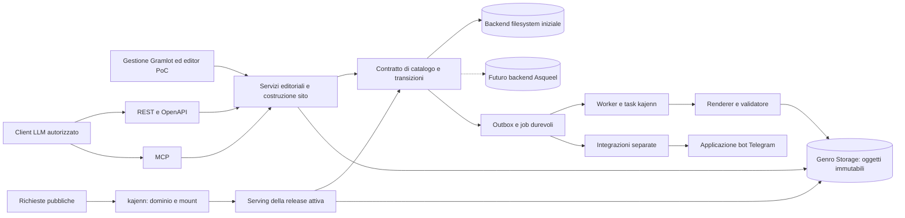
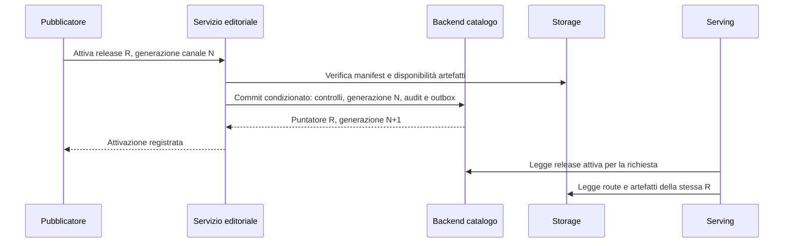

# 03 · Architettura e flussi

Stato: proposta. I componenti già presenti e le estensioni sono distinti in
[07](07-capacita-verificate.md); non si assume che l'intero flusso esista.

## Confini applicativi

La base `McpOpenApiApplication` espone comandi e interrogazioni dei servizi.
La UI Gramlot chiama gli stessi servizi tramite il proprio percorso autenticato;
un'integrazione in-process può evitare un giro HTTP, ma deve passare lo stesso
contesto di identità, sito e autorizzazione. Nessun client accede direttamente a
database o storage. La copertura MCP/REST comprende anche sorgenti dei template,
blocchi HTML/Markdown, mapping Data, CSS/JS, validazione e diagnostica di build.
La scoperta dei contratti e la lettura degli artefatti consentono il ciclo
autonomo lettura → modifica → validazione → anteprima → correzione. Le funzioni
applicative non devono esistere soltanto come handler dei pulsanti del pannello.

Raccomandazione: applicazione editoriale per gestione/API e applicazioni di
serving configurate per i siti, con servizio applicativo condiviso. L'adapter
Gramlot kajenn può ospitare il pannello; il collegamento al servizio editoriale
è lavoro di integrazione da progettare. Non si assume che ereditarietà multipla
fra adapter Gramlot e `McpOpenApiApplication` componga automaticamente i protocolli.

Il codice kajenn verificato smista per primo segmento del percorso. Il multisito
per dominio richiede una mappatura di deployment verificata: proxy davanti a
istanze/mount oppure risoluzione dei domini nell'applicazione editoriale di root.
Non è dichiarata una funzione virtual-host nativa. I mount dell'host hanno
precedenza: catalogo delle route riservate e prefissi devono entrare nelle
validazioni del sito. Modificare la configurazione dell'host richiede una verifica
di compatibilità con i siti attivi.

## Backend filesystem iniziale e integrazione Asqueel futura

**Scelta acquisita:** partire con gestione su filesystem e Genro Storage,
senza dipendenza da Asqueel o PostgreSQL. Asqueel è un futuro backend del
catalogo; il suo collegamento con kajenn e Gramlot rimane aperto e non blocca
l’avvio. PostgreSQL resta il riferimento per quel futuro backend SQL.

I servizi comuni a Gramlot, REST e MCP dipendono da un contratto di catalogo:
letture, ricerca, salvataggio condizionato alla generazione, transizioni,
idempotenza, audit, job ed eventi pendenti. È un contratto applicativo da
progettare, non un’API già presente nei framework. Genro Storage mantiene il
proprio ruolo per payload e artefatti; non viene simulato un database sotto
ogni accesso a un file.

Per il backend iniziale si propone un solo coordinatore delle scritture su
filesystem locale, con manifest immutabili e pubblicazione atomica di una
generazione di catalogo. Il protocollo e i limiti sono in [06](06-storage-consistenza.md).
UI, API e worker passano sempre da questo coordinatore: scritture manuali nei
file autorevoli non sono un secondo percorso supportato. Importare file è
un’operazione dei servizi con validazione e controllo della base.

L’integrazione futura dovrà definire ownership del runtime Asqueel, connessioni,
transazioni nelle richieste e nei job e propagazione dell’identità. Il rapporto
fra servizi e Data Gramlot va comunque definito per la prima implementazione,
senza attendere binding persistenti specifici di Asqueel.

La sostituzione richiede migrazione verificata di identità, versioni, grant,
generazioni, ricevute idempotenti, audit e job pendenti; conserva i riferimenti
storage. Scritture sospese durante il passaggio, verifica del catalogo importato
e cambio di backend autorevole. Niente doppia scrittura implicita. Entrambi i
backend devono superare gli stessi controlli di contratto; prestazioni e capacità
di concorrenza possono differire e vanno dichiarate.

## Editing e revisione

1. L'autore apre una variante. Il servizio restituisce snapshot, generazione,
   capacità effettive e schema dei campi.
2. Il client conserva il buffer non ancora salvato, invia uno snapshot coerente
   di testo/metadati/riferimenti e la generazione letta.
3. Il servizio verifica ambito, schema e conflitti, prepara gli oggetti immutabili
   e completa il salvataggio secondo [06](06-storage-consistenza.md).
4. La creazione di una revisione editoriale promuove un preciso snapshot a
   checkpoint, con autore, messaggio e provenienza. Non è una copia mutabile.
5. La richiesta di revisione congela il riferimento valutato. Commenti e decisioni
   sono collegati a quella revisione, anche se l'autore continua a lavorare.
6. Una modifica richiesta genera una nuova revisione. La precedente conserva la
   propria storia; eventuali approvazioni sono da rinnovare secondo la policy.

Nel futuro backend Asqueel, per ogni operazione SQL la transazione intera
deve vivere in un unico helper
sincrono eseguito da kajenn, con commit/rollback e chiusura delle connessioni del
worker. Separare singole query in chiamate al pool non garantisce lo stesso thread.
Nessuna transazione SQL resta aperta durante upload o rendering.

## Candidato, anteprima e build

La selezione del candidato usa una generazione coerente del catalogo; nel backend
filesystem legge il manifest selezionato una sola volta. Nel futuro backend SQL
richiederà una transazione breve o un controllo equivalente delle generazioni.
Include revisioni linguistiche, navigazione, collezioni, tassonomie,
configurazione, template Gramlot/HtmlBuilder, contratto Data, sorgenti CSS/JS,
tema, renderer e dipendenze. Sono risolti subito anche i riferimenti
interni: a build avviata nessun worker sceglie «l'ultima versione».
La selezione rispetta la pubblicazione indipendente delle lingue: aggiornando
una variante, può mantenere le revisioni già pubblicate delle altre, senza
includerne le bozze. Una lingua non ancora pubblicata resta fuori dalle route
e dagli alternate della release. L’indipendenza editoriale delle lingue resta
compatibile con l’attivazione di una release coerente dell’intero sito.

L'anteprima usa lo stesso candidato e la stessa pipeline del pubblico. I link
puntano all'origine privata di anteprima, mentre un pannello mostra gli URL
canonici previsti per il canale finale. La differenza di origine e gli header di
protezione sono espliciti; non si promette uguaglianza dei byte HTML fra anteprima
e produzione.

Pipeline proposta:

1. Validare schemi, autorizzazioni di uso, componenti e chiusura delle dipendenze.
2. Produrre il piano URL completo: pagine, lingue, indici, tassonomie, corsi,
   paginazione, feed, redirect e pagine di errore.
3. Preparare i blocchi: parsing Markdown oppure elaborazione HTML da Jodit, con
   profili versionati; validare/sanitizzare i frammenti, risolvere link per ID,
   media e componenti. Conservare il sorgente e identificare i derivati.
4. Popolare la Data Bag secondo il contratto del template: metadati, frammenti HTML,
   dati strutturati e risorse. Renderizzare staticamente il template con il motore
   dichiarato, Gramlot oppure HtmlBuilder. Generare gli asset CSS/JS dalle revisioni
   selezionate, manifest di route, metadati, sitemap e risorse globali.
5. Verificare link/anchor, collisioni, accessibilità strutturale, HTML senza JS,
   dipendenze, assenza di riferimenti privati e coerenza SEO.
6. Scrivere un ArtifactSet completo sotto namespace immutabile; sigillare il
   manifest solo dopo verifica di tutti gli oggetti.
7. Registrare SiteRelease pronta, con attestazione dei controlli e digest.

La build completa è la semantica di riferimento. Quella incrementale riutilizza
artefatti solo quando coincidono input e dipendenze: testo, template, menu,
tassonomie, elenco delle traduzioni, profilo renderer e configurazione. Il grafo
comprende dipendenze inverse, per esempio la pagina indice aggiornata da un nuovo
articolo. Il risultato deve equivalere alla build completa; in assenza di prova
di indipendenza si ricompila. Non si riscrive la directory pubblica in-place.

Una preview della sola pagina è una comodità rapida; l'anteprima dell'intera
release resta necessaria per navigazione, URL e pubblicazione.

## Attivazione e serving

Il punto di attivazione è il commit del catalogo: nel backend iniziale la
pubblicazione atomica della nuova generazione, in quello futuro il commit SQL.
Il servizio ricontrolla revoche, approvazioni richieste, compatibilità del canale
e generazione del binding operativo prima di finalizzare. La verifica
preliminare dello storage resta valida
solo perché retention e writer impediscono modifica/eliminazione degli oggetti
referenziati; non è una transazione distribuita.

Ogni richiesta risolve host/prefisso autorizzato, sito/canale, release, route e
artefatto. L'app legge il puntatore una volta e conserva quel valore fino al
termine della risposta. HTML e asset referenziati appartengono allo stesso
manifest; gli asset hanno URL immutabili. Link di navigazione normali possono
portare alla nuova release alla richiesta successiva: non si promette una sessione
di navigazione interamente fissata a un'edizione.

Per HTML canonico, raccomandazione iniziale di garanzia: risoluzione autorevole
del puntatore per richiesta e nessuna cache condivisa che serva risposte scadute
senza rivalidazione. I manifest e gli asset immutabili sono liberamente
cacheabili secondo la loro visibilità. Una CDN che conserva HTML introduce una
finestra di propagazione: va scelta e misurata esplicitamente, con stato
«attivata all'origine» distinto da «propagata». Non si dichiara switch atomico
globale della CDN.

Il rollback attiva una release conservata e nuovamente validata, tramite lo stesso
CAS; non ricompila e non riscrive i contenuti. Conserva audit ed eventi come una
nuova attivazione. Una release revocata o incompatibile con i domini correnti non
è un obiettivo valido.

## Generazione preventiva e lavoro a richiesta

Pre-generare testo editoriale, indici, navigazione, pagine di corso, fallback dei
componenti, dati strutturati e sitemap. A richiesta eseguire autenticazione,
anteprime protette, ricerca dinamica eventuale e interazioni Gramlot.

Per ricerca pubblica si propone un indice per release, con risultati legati al
catalogo pubblicato; una ricerca lato server può leggere tale proiezione. La
scelta del motore non è ancora fatta. La ricerca amministrativa include bozze
solo secondo permessi e ha un indice distinto.

Personalizzazione e dati live non possono sostituire testo essenziale o canonical.
La direzione acquisita usa il renderer HTML di Gramlot o HtmlBuilder per i
template dichiarativi. Il rendering statico non esegue automaticamente il
JavaScript del browser e non dimostra hydration dei componenti. I template
statici devono poter risolvere i propri dati durante la build; regioni live e
bootstrap pubblico richiedono un contratto distinto.

È acquisita l’integrazione dei componenti Gramlot direttamente nella pagina.
L’iframe è previsto solo quando serve un confine di isolamento esplicito.
Bootstrap, scope Data e lifecycle vanno qualificati per più componenti nello
stesso documento; il contenuto essenziale rimane nell’HTML statico anche se
il runtime non si avvia o un componente fallisce.

Testo ordinario e frammenti HTML hanno contratti diversi: il primo viene
escapato; i secondi vengono inseriti come markup solo dopo la preparazione
prevista. Il supporto raw HTML osservato nel renderer base non è una
sanitizzazione. Il dettaglio di binding/inserimento deve essere qualificato
per entrambi i motori, senza attribuire a tutti i componenti la stessa capacità.

Template Python e risorse CSS/JS sono sorgenti intenzionalmente modificabili
anche via LLM con i grant appropriati. La loro validazione e compilazione
avvengono nei job di build previsti; il salvataggio non esegue il codice
nel contesto della richiesta amministrativa. Il worker deve avere dipendenze
fissate e un ambiente di esecuzione coerente con la fiducia accordata agli autori
dei template, separato dai segreti dell'host e dai dati non destinati al sito.

## SEO e lingue

Il piano URL gestisce slash finale, normalizzazione Unicode, caratteri codificati,
slug localizzati, redirect e percorsi riservati. Si rifiutano segmenti di traversal,
encoding ambiguo e collisioni dopo normalizzazione; la policy esatta sarà versionata.

Ogni pagina include lingua, titolo, descrizione, heading strutturati, URL canonico,
metadati social e dati strutturati coerenti col contenuto visibile. Canonical e
sitemap derivano dalla stessa mappa; una traduzione non canonicalizza normalmente
alla lingua principale. Gli alternate `hreflang` comprendono solo varianti
pubblicate e riferimenti reciproci; `x-default` è una scelta esplicita.
Riferimenti: [canonical Google](https://developers.google.com/search/docs/crawling-indexing/consolidate-duplicate-urls)
e [versioni localizzate](https://developers.google.com/search/docs/specialty/international/localized-versions).

La sitemap contiene URL pubblici canonici e date di modifica editoriale pertinenti,
non l'ora di ogni ricompilazione; è suddivisa secondo il
[protocollo sitemap](https://www.sitemaps.org/protocol.html). Il mapping a dati
strutturati è per tipo di contenuto e viene validato: non si promettono risultati
arricchiti, la cui visualizzazione dipende dal motore
([documentazione Google](https://developers.google.com/search/docs/appearance/structured-data/intro-structured-data)).

Anteprime e collaudo richiedono autenticazione, `no-store` e `noindex`; robots non
è un controllo di accesso. Un URL pubblico sconosciuto restituisce 404; un ritiro
può scegliere 410 o redirect mediante decisione editoriale, non una pagina 200 vuota.

## Integrazioni e gestione operativa

Eventi proposti: revisione richiesta/decisa, build riuscita/fallita, release
attivata, risorsa non valida. Ogni evento contiene ID, versione dello schema,
sito, attore e correlazione; i destinatari ricevono solo il payload necessario.
Audit, metrica di esecuzione e notifica sono tre registri diversi.

L'outbox è registrata nello stesso commit di catalogo del cambiamento. Un relay consegna
almeno una volta; ogni destinatario deduplica per ID. Nessuna notifica prima del
commit. Un errore Telegram non annulla una pubblicazione.

`kajenn-bot-application` offre già invio, webhook con secret e task di notifica;
l'aggancio al dominio editoriale è nuovo. Comandi possibili: stato revisione,
assegnazioni e richiesta di preview. La mappatura utente Telegram → principal
editoriale è esplicita; la provenienza dal webhook non concede il permesso di
pubblicare. Un futuro comando di attivazione deve indicare release e generazione
precise e applicare le stesse policy della UI. Esiti incerti di invio non vanno
ritentati alla cieca: duplicati esterni possono restare possibili.

Job applicativi registrano intenzione ed esito nel backend del catalogo. Il task kajenn fornisce
esecuzione e progresso; i due ID sono correlati. Claim, retry e riconciliazione
sono progettati nel prodotto, non attribuiti automaticamente allo spool. In
particolare lo spool usa spostamenti di directory e non è dimostrato corretto su
S3. Metriche previste: età outbox, build bloccate, errori hash, oggetti orfani,
conflitti, ritardi di attivazione e propagazione.
