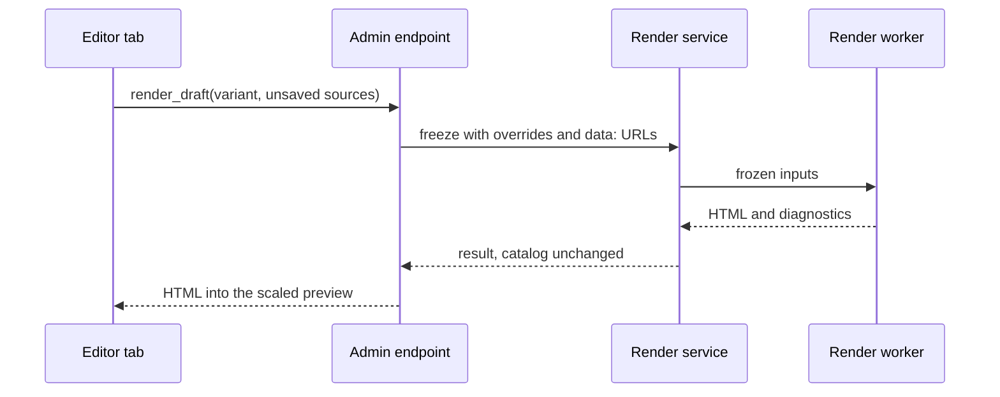

<!-- generated from site-editor.xml by xmldocs: do not edit, edit the XML -->

## Kajenn Press administration as a site editor
*Proposal · site-editor · 2026-10-26 · draft*

### Problem

Kajenn Press must become the tool used to create and edit sites interactively. An author writes a Gramlot template, sees the rendered page next to the editor, and edits contents and CSS from the administration with Gramlot editors.

The administration today is mostly a browser. Its only editing workspace supports one template shape: one required HTML block named `body`. A site built with other blocks, such as the Kajenn Press presentation site with `hero` and `body`, can be edited only through MCP or REST.

The rendered preview shows saved revisions only, and without the CSS and images of the site.

### Current state

- `READ` `src/kajenn_press/admin/pages/index.py:13` · 2026-10-26 — The administration shell is an `IndexPage` with a site selector in the top bar, a navigation tree on the left and retained iframe tabs in the center.
- `READ` `src/kajenn_press/admin/pages/author.py:9` · 2026-10-26 — The authoring page declares `BLOCKS = {"body": {"format": "html", "required": True}}` and refuses templates whose blocks differ, with the message at line 107.
- `READ` `src/kajenn_press/admin/pages/author.py:239` · 2026-10-26 — The authoring page shows the result of `render_preview` in an `htmlPreview`.
- `READ` `src/kajenn_press/application.py:416` · 2026-10-26 — `render_preview` takes a `variant_id` and an exact saved `revision_id`: unsaved edits cannot be rendered.
- `READ` `src/kajenn_press/rendering/inputs.py:90` · 2026-10-26 — Resource URLs in Data default to `/_resources/<sha256>.<suffix>`; `freeze` accepts a `resource_urls` override (line 22).
- `READ` `gramlot/js/src/components/html-preview.js:13` · 2026-10-26 — `htmlPreview` renders its value through `srcdoc` in an iframe with `sandbox=""` and has no zoom parameter.
- `READ` `src/kajenn_press/admin/host.py:91` · 2026-10-26 — The administration CSP allows `style-src 'self' 'unsafe-inline'` and `img-src 'self' data:`.
- `READ` `src/kajenn_press/admin/views.py:189` · 2026-10-26 — The login view and the top bar still show the former name "kajenn public site"; the login has no logo.

A sandboxed iframe without `allow-same-origin` has an opaque origin, so `/_resources/` URLs and session cookies cannot serve the preview. This follows from the HTML specification and was not tested in the administration.

- Publication from the administration is a later phase; build, activation and rollback are available through MCP and REST only. · `docs/13-amministrazione.md`

### Proposed solution

#### Shell and navigation

The shell stays an `IndexPage`. Each opened object gets its own retained tab: a page, a template, a stylesheet, a script or a media item.

*Shell regions*

| Region | Content |
|---|---|
| top | Kajenn Press logo at 48 px with the text name, site selector, New site, account and Sign out |
| left | Navigation tree of the current site: Pages, Templates, Styles, Scripts, Media, Publishing; then Shared library and Deployments |
| center | One retained tab per opened object, closable |
| bottom | Status: save state of the active tab and permissions in the current scope |

Each tree group lists its records. Selecting a record opens its editor tab, or selects the tab when it is already open. A New command in each group creates a record of that kind.

- **must** — Behaviour uses Source, Data, bindings and components; no imperative DOM manipulation. *(Gramlot constitution)*

#### Login and identity

The login card shows the Kajenn Press logo, `assets/kajenn-press/logo/kajenn-press-256.png` displayed at 160 px, the minimum size for the full logo in the identity guide. Labels "kajenn public site" become "Kajenn Press".

- **must** — The logo is never cropped, rotated, stretched, shadowed or recoloured. *(assets/kajenn-press/theme-guide.md)*

#### Page editor

The page editor opens one language variant.

- Toolbar: Save draft, Revert, Revisions, Open template, Readiness.
- Left pane: one tab per block declared by the template. HTML blocks offer Jodit (`htmlEditor`) and the source (`codeMirror`, html). Markdown blocks offer `markdownEditor` and the source.
- Right pane: the scaled preview. A splitter separates the panes.

This removes the single-block limit of the current authoring page.

#### Resource editor

- Templates, CSS and JavaScript open in `codeMirror` with their language. Cmd+S saves a new revision.
- Next to the code, the preview renders a sample page of the site with the resource being edited.
- A template also shows a form for its block declarations and its dependencies.
- Media show upload and a view of the file.

#### Live preview

A new operation, `render_draft`, renders unsaved sources. It receives the variant and, optionally, unsaved block sources and unsaved resource sources that replace their saved revisions for this render. It freezes the inputs, runs the worker and returns HTML and diagnostics. It writes nothing to the catalog.

- **must** — render\_draft requires the same permissions as render\_preview: build and read on the site, read and use on the resources.

The editor calls `render_draft` about 800 ms after the last edit. A newer call replaces an older one.

For the preview, `freeze` receives `resource_urls` with `data:` URLs of the exact resource bytes, so CSS and images load inside the sandboxed iframe. The administration CSP adds `data:` to `style-src` (→ d-css-policy).

The preview renders the page at a fixed width, 1280 px or 375 px, inside a container scaled with `transform: scale()`. A selector offers 0.5, 0.75 and 1.

*Live preview flow*

#### Phases

1. Shell, login and navigation: logo, names, navigation tree, one tab per object, status bar.
2. Preview infrastructure: `render_draft` on REST and MCP, `data:` resource URLs, `data:` in the administration `style-src`, scaled preview container.
3. Page editor with all declared blocks and the live preview.
4. Resource editor for templates, CSS, JavaScript and media with the live preview.
5. Publishing panel: candidate, build, preview grant, activation and rollback.

### Decisions

- **d-render-draft** `decided` — How does the preview show unsaved edits?
   1. **New render_draft operation**: Renders unsaved sources without writing to the catalog.
   2. **Save on every edit**: Every save creates an immutable revision.
   → Choice: **New render_draft operation** (GP, 2026-10-26) — History holds only deliberate saves.
- **d-shell** `decided` — Which shell hosts the editors?
   1. **IndexPage with one tab per object**
   2. **Gramlot IdePage**: Built on a filesystem tree, not on catalog records.
   → Choice: **IndexPage with one tab per object** (GP, 2026-10-26) — The current shell already uses it.
- **d-preview-resources** `decided` — How do CSS and media reach the sandboxed preview?
   1. **data: URLs through resource_urls**
   2. **Admin endpoint serving resource revisions**: The opaque origin of the sandboxed iframe sends no session cookie.
   → Choice: **data: URLs through resource_urls** (GP, 2026-10-26) — Needs no new endpoint and no cookie.
- **d-css-policy** `decided` — How is a data: stylesheet admitted by the administration CSP, which allows style-src 'self' 'unsafe-inline' only?
   1. **Add data: to style-src**: One change in `src/kajenn_press/admin/host.py`; templates keep their `link` elements.
   2. **Inline the stylesheet in the preview**: The preview rewrites each stylesheet link into a `style` element; the rendered HTML differs from the release.
   → Choice: **Add data: to style-src** (GP, 2026-10-26) — The preview keeps the same HTML as the release.

### Consequences

Each `render_draft` call starts a worker process, with the configured timeout of 15 seconds by default. The delay of about 800 ms limits the calls while typing.

The `data:` URLs enlarge the preview HTML by the size of the CSS and media of the page, up to the existing input limit of 32 MiB.

The current authoring page and the browse pages are replaced by the new editors.

### Related documents

- `docs/13-amministrazione` — Gramlot administration, phase 1
- `docs/10-rendering-statico` — Static rendering contract v1
